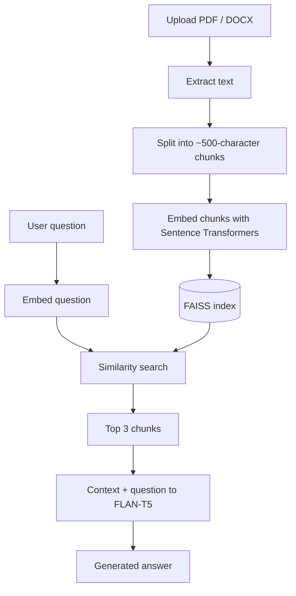

# RAG Document Question Answering

A Django web app where you upload a PDF or DOCX file and ask questions about it. It finds the most relevant passages with vector search, then generates an answer from them using a language model.

**Stack:** Python · Django · Sentence Transformers · FAISS · Hugging Face Transformers (FLAN-T5) · YugabyteDB

## Problem

Finding a specific answer inside a long document is slow. This project retrieves only the relevant parts of a document and answers from them, so you don't have to read the whole file.

## How it works

1. **Extract:** text is pulled from the file with PyMuPDF (PDF) or python-docx (DOCX).
2. **Chunk:** the text is split into chunks of about 500 characters.
3. **Embed:** each chunk becomes a 384-dimensional vector using `all-MiniLM-L6-v2`.
4. **Index:** the vectors are stored in a FAISS index.
5. **Retrieve:** the question is embedded the same way, and FAISS returns the 3 closest chunks.
6. **Generate:** the chunks and the question are passed to `google/flan-t5-base`, which writes the answer.

## Features

- Upload PDF and DOCX documents
- Semantic search over the document content
- Context-based answer generation
- Web interface built with Django, HTML, and CSS
- Data stored in YugabyteDB (PostgreSQL-compatible)

## Tech stack

| Component | Technology |
|---|---|
| Language | Python |
| Backend | Django |
| Document parsing | PyMuPDF, python-docx |
| Embeddings | Sentence Transformers (`all-MiniLM-L6-v2`) |
| Vector search | FAISS |
| Answer generation | Hugging Face Transformers (`google/flan-t5-base`) |
| Database | YugabyteDB (PostgreSQL-compatible) |
| Frontend | HTML, CSS |

## Limitations

- Works only with PDF and DOCX files that contain selectable text (no OCR for scanned documents)
- Fixed-size chunking can split a sentence or idea across two chunks
- Always retrieves exactly 3 chunks
- Basic retrieval only, with no hybrid search or reranking
- Answer quality depends on retrieval quality and on the small FLAN-T5 model

## Roadmap

- [ ] Show source passages next to each answer
- [ ] Semantic chunking
- [ ] Hybrid search and reranking
- [ ] OCR for scanned documents
- [ ] User login and per-document access control
- [ ] Option to use a hosted LLM API for better answers

## Purpose

I built this to learn how retrieval-augmented generation works in practice: how document processing, embeddings, vector search, and text generation fit together, and how much answer quality depends on the retrieval step.

## Author

Dharini M ([@dharini03](https://github.com/dharini03))
